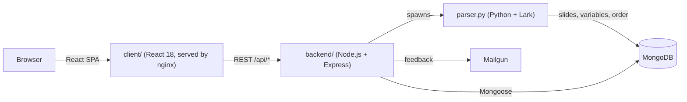

# Stepwise Source

**Turn a piece of source code into a step-by-step, interactive demonstration.**

Stepwise Source lets a teacher (or anyone explaining code) write a short annotated script once and get back a web presentation that reveals the code slide by slide, highlights the parts that matter, attaches explanations to them, and can ask the viewer to fill in missing pieces.

- **Live:** https://stepwisesource.epl.di.uminho.pt
- **Context:** MSc thesis at the University of Minho, *Tool for Progressive Source Code Demonstration*
- **Paper:** Santos, J., Costa Neto, Á. & Henriques, P. R. (2025). *Stepwise Source, a Supporting Tool for Source Code Demonstration.* SLATE 2025, OASIcs Vol. 135. [doi:10.4230/OASIcs.SLATE.2025.10](https://doi.org/10.4230/OASIcs.SLATE.2025.10)

## The problem

When you teach programming, a finished listing on a slide is the worst way to show how code gets built. You end up either duplicating the same snippet across a dozen slides (and keeping them in sync by hand) or live-coding and hoping nothing breaks. Neither lets you point at a specific token and say "this is the bit to look at", and neither checks whether the audience is following.

Stepwise Source treats the demonstration as data. You describe the slides, the styles and the order in a small markup language, and the tool generates the presentation.

## Features

- **A small DSL for demos.** Commands such as `\slide{id}{title}`, `\description{...}`, `\begin ... \end` code blocks, and `\order{a,b,(c|d),e}` describe the content and the sequence of slides, including alternative branches with `|`.
- **Reusable styles.** `\newfixed{name}{color: red; bold}` and `\newreactive{name}{...}` define named styles that can then wrap any part of the code, with an optional annotation shown next to it.
- **Inline exercises.** `\exercise{regex}{hint}` replaces part of the code with an input box, and the viewer's answer is checked against a regular expression.
- **In-browser editor.** Create and edit demos from the web app (CodeMirror), upload or download the source script, and get a shareable demo ID.
- **Presentation list, tutorial and documentation pages.** The built-in tutorial is itself a Stepwise Source demo, generated from the `tutorial` script when the backend starts.
- **Feedback form** that sends an email through Mailgun.

## Architecture



1. The editor posts the demo script to the Express API (`POST /api/demo`, `POST /edit/demo`).
2. Express hands the script to `parser.py`, which parses it with a Lark grammar and a tree interpreter, then writes the resulting slides, style variables and slide order to MongoDB.
3. The viewer fetches a demo by ID (`GET /api/:idDemo`) and the React app renders each slide, applying the styles, annotations and exercises.

Keeping the language in a proper grammar (rather than ad hoc string handling) is what makes nested styles, annotations and branching order expressions manageable.

## Stack

| Layer | Tech |
|-------|------|
| Frontend | React 18, React Router 6, CodeMirror (`@uiw/react-codemirror`), Prism.js, MUI, styled-components, Create React App |
| Backend | Node.js, Express 4, Mongoose 8, Mailgun |
| Language processing | Python 3, Lark 1.1.5, PyMongo |
| Data | MongoDB |
| Deployment | Docker Compose (mongo, backend, frontend on nginx) |

## Running locally

### With Docker Compose

The compose file and Dockerfiles expect env files that are not committed. Create them first:

- `.env.production` at the repo root (loaded by the `backend` service)
- `backend/.env.production` and `client/.env.production` (copied into the images)

The client reads values such as `REACT_APP_API_URL`, `REACT_APP_BASE_URL` and `REACT_APP_EXPRESS_PORT`. The backend reads `MONGO_URI` (set by compose) and, optionally, `MAILGUN_API_KEY` for the feedback form.

```bash
REACT_APP_API_URL=http://localhost:50741 docker compose up --build
```

| Service | Port |
|---------|------|
| Frontend (nginx) | http://localhost:50740 |
| Backend (Express) | http://localhost:50741 |
| MongoDB | localhost:50744 |

On start the backend waits for MongoDB, loads the tutorial demo with `parser.py`, then runs `npm start`.

### Without Docker

You need Node.js, Python 3 and a MongoDB instance listening on port 50744 (the default port in `backend/app.js` and `backend/parser.py`).

```bash
# backend
cd backend
pip3 install -r requirements.txt
npm install
python3 parser.py tutorial 'How to create your presentation' IDtutorial   # optional: load the tutorial
npm start                                                                 # Express on :50741

# frontend, in another terminal
cd client
npm install
npm start                                                                 # React dev server on :50740
```

## Repository structure

```
.
├── backend/
│   ├── app.js, bin/www        Express app and server entry
│   ├── routes/                REST API (demos, edit, presentations, feedback)
│   ├── controllers/, models/  Mongoose models: demo, variable, order
│   ├── parser.py              Lark grammar + interpreter that turns a script into slides
│   ├── tutorial               Source script of the built-in tutorial demo
│   └── Dockerfile, wait-for-mongo.sh
├── client/
│   ├── src/pages/             Home, NewDemo (editor), Demo (viewer), Presentations, Documentation, About
│   ├── src/components/        Annotation, TextBox, StyledHTML, modals, navigation
│   └── Dockerfile, nginx.conf
└── docker-compose.yaml
```

## Screenshots

_Screenshots to be added: the editor, a demo slide with highlights and annotations, and an exercise box._

## Authors

João Santos. The SLATE 2025 paper is co-authored with Álvaro Costa Neto and Pedro Rangel Henriques (University of Minho).
